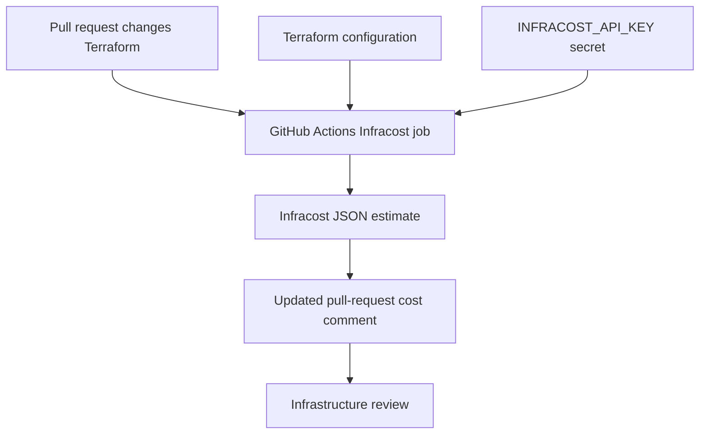

# Terraform Cost Estimation Template

A Terraform project template that uses Infracost in GitHub Actions to estimate infrastructure costs and publish a cost comment on pull requests.

**Status:** Includes example EC2/S3 configuration and a PR workflow. Cost estimation reads Terraform configuration; the workflow does not apply infrastructure.

## Architecture

## Start here

Create a project from this template and configure the `INFRACOST_API_KEY` repository secret. Inspect [.github/workflows/infracost.yml](.github/workflows/infracost.yml) and [terraform/main.tf](terraform/main.tf). Replace the example infrastructure values before any separate deployment.

[Previous README and detailed reference](https://github.com/mtzanida/infracost/blob/bab4ad94c172a566df765a0d50419a2cde98b7a1/README.md) are retained in Git history. They may describe older assumptions or unmerged plans; the scope above reflects this branch.
